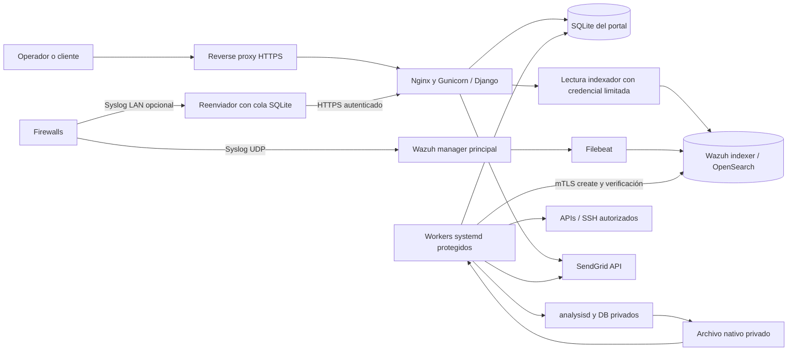

# Arquitectura

## Componentes

Es un monolito Django organizado por dominios, con HTML de servidor y JavaScript acotado. No hay Celery, Redis, bus externo ni SPA en este snapshot. Los trabajos de fondo son procesos systemd independientes. La base operativa del portal es SQLite; el índice de alertas y la base interna de Wazuh son almacenes distintos.

## Fronteras de confianza

| Componente | Responsabilidad | Límite |
|---|---|---|
| Web como `socportal` | Sesión, permisos, UI, validación, datos de aplicación | No debe leer la clave mTLS administrativa ni ejecutar tareas root genéricas. Algunas conexiones expresamente permitidas desde el panel configuran equipos; no todo es solo lectura. |
| Workers root | Recepción local, sincronización, índices/roles, recuperación y operaciones protegidas | Nombres de trabajo cerrados, locks, presupuestos y auditoría; nunca una orden arbitraria del navegador. |
| Reader del indexador | Consultas de informes y recuperación | Credenciales separadas del administrador; respuesta completa validada antes de actualizar estado. |
| Ámbito de cliente | Filtro por petición y proyección explícita | `None` en ContextVar es ámbito sin filtro. Workers y endpoints públicos no heredan automáticamente una restricción de cliente. |
| Fuentes | Hechos del fabricante y logs | Una conexión de gestión no certifica detección ni eficacia de bloqueo. |

## Recorrido de una petición

`socportal/urls.py` y `core/urls.py` → middleware de seguridad → vista/formulario → servicio de dominio → ORM o conector → template/JSON/PDF. El middleware establece y limpia `customer_scope`/`actor_scope` con ContextVar, valida el acceso y MFA. Las vistas sensibles añaden permisos y MFA reciente. Los endpoints públicos usan su propio token/firma y ámbito.

## Recorrido de eventos

La ruta existente lee `alerts.json` y recupera el índice con cursores. `operations.normalize` y `event_contract` generan la interpretación común; `SourceOwnership` congela pertenencia temporal; la ingestión registra evidencia, feeds y episodios/incidentes sin inflar duplicados. El canal HTTPS añade una bandeja cifrada y una instancia nativa aislada antes de indexar. Véase [ingesta](ingestion.md).

## Consistencia

Las transacciones reúnen cambios que deben confirmarse juntos: reserva de escritor, evidencia y checkpoint, deduplicación y contador. SQLite requiere reservar el escritor antes de lecturas que luego se convertirán en escrituras; conservar esos patrones durante la migración a PostgreSQL y volver a probarlos. No sustituir una transacción por varias llamadas HTTP/SQL independientes con la misma apariencia visual.

## Estructura

- `core/models.py` importa también los modelos repartidos en `access_models`, `operations_models`, `improvement_models`, `network_models` y `vpn_security`.
- `core/operations.py`, `event_contract.py`, `source_ownership.py`: significado y propiedad del evento.
- `core/background_jobs.py` y management commands: operación programada.
- `templates/`, `static/`, `public/`: interfaz, marca y acceso público.
- `deploy/`: instalador, unidades, relay, reglas y decodificadores. Contiene también utilidades históricas con rutas/IDs de una instalación; revisarlas antes de ejecutar.
- `docs/reference/`: inventarios estáticos regenerables, no telemetría.

El [mapa de módulos](reference/modules.md) localiza los servicios de cada dominio; [decisiones](decisions.md) explica restricciones y deuda deliberada.
