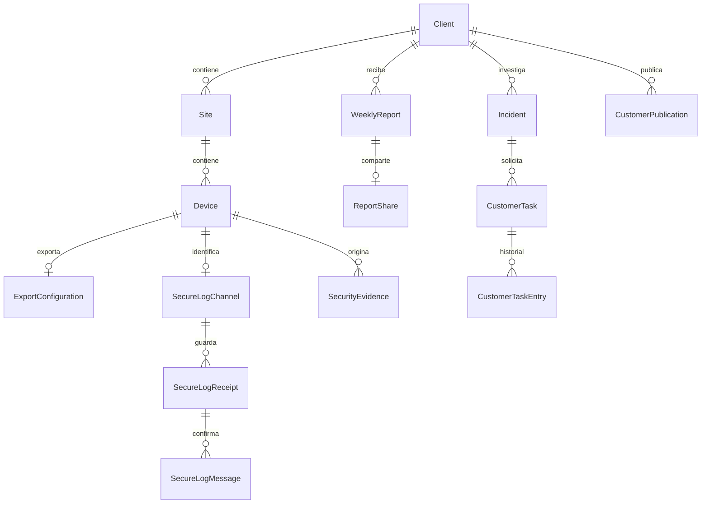

# Modelo de datos e identidades

## Relaciones principales

Diagrama de lectura, no sustituto de los `on_delete`/constraints reales. El [catálogo de modelos](reference/models.md) detalla campos y referencias.

## Dominios

| Dominio | Entidades principales | Fuente |
|---|---|---|
| Organización | Client, Site, Device, FirewallOnboarding, ExportConfiguration | `core/models.py` |
| Gestión del equipo | UnifiCloudConnection, OpnsenseConnection, HillstoneConnection, GdmsConnection, SshConnection | `core/models.py` |
| Autenticación | User de Django, StaffAccess, MfaProfile, AuthAttempt, UserInvitation | modelos operativos y de acceso |
| Observación | Asset, DeviceHealth, DeviceFeed, FeedBucket, SecurityEvidence, SourceOwnership, AttributionCatalog | modelos operativos / principales |
| Investigación | Incident, IncidentUpdate, IncidentAction, RunbookStep, CustomerTask, CustomerTaskEntry, ChangePlan | modelos principales, operativos y de mejora |
| Cobertura | ProtectionPolicy, ProtectionValidation, NetworkCoverage, NetworkCheck, AdvancedReview, ZenarmorExportRequest | modelos operativos, de red y de mejora |
| Comunicaciones | WeeklyReport, ReportShare, CustomerPublication, MailSettings, MailDispatch, MailEvent, UrgentAlert | modelos principales y de mejora |
| Operación | WorkerState, OperationalIssue, AuditEvent, ConfigurationArchive, RecoverySettings, BackupRun, VpnPeer, VpnAccessEvent | varios módulos |

## Identidades que no son intercambiables

- `Device.pk`: identidad local de la ficha; no es IP, MAC ni ID cloud.
- MAC normalizada: vincula inventario y equipo físico cuando el proveedor la acredita. No prueba por sí sola la propiedad histórica de todos los logs.
- IDs cloud/host/site: seleccionan el equipo remoto dentro de una cuenta; deben quedar ligados al cliente correcto.
- IP de transporte: puede cambiar o ser la de un NAT. En HTTPS no identifica al cliente: lo hace el canal autenticado.
- `source_identity` HTTPS: alias local reservado de `127.80.0.0/16`; no representa una dirección WAN. Su asignación y guardas son internas.
- `SourceOwnership`: intervalos temporales por fuente; dueño nulo representa ambigüedad. No reasignar todo el histórico al cambiar una ficha.
- `SecurityEvidence.client_scope_id`: propiedad congelada; la interpretación histórica se conserva en su snapshot.
- UUID de lote + digest + posición → UID estable por mensaje. No cambiar estos componentes al reintentar.

## Estados de transporte

Lotes nuevos v2: `queued` → `awaiting` → `confirmed`, o `failed` retenido para revisión. Cada mensaje tiene `processed_at`, y las alertas además `indexed_at`; `projected_at` impide repetir su contribución al portal. Los mensajes sin alerta pueden confirmar su procesamiento sin crear evidencia de seguridad.

Lotes v1 previos: `legacy`, `queued`, `delivering`, `retry`, `forwarded`, `uncertain`, `failed`. `forwarded` acredita un intento UDP, no confirmación Wazuh. No convertir automáticamente un envío ambiguo antiguo en v2 confirmado.

## Estados de acceso y correo

Una invitación usa token de un solo uso y expira; `accepted` en su estado de envío significa aceptación del proveedor, mientras `accepted_at` acredita que el usuario estableció contraseña. GET de un escáner de correo no consume el enlace. La invitación anterior se invalida al rotar/reinvitar.

Un correo tiene aceptación del proveedor y, si se activa el webhook firmado, eventos posteriores de entrega/rechazo. No agrupar esos hechos bajo una única etiqueta de éxito. Las tareas de cliente tienen estados y visibilidad propios; lo interno no se publica por la simple existencia de una incidencia.

## Tareas del cliente

`CustomerTask.response` y `review_note` guardan solo la última respuesta y revisión; `CustomerTaskEntry` conserva cada una (autor, fecha y estado) y no se edita. La migración `0048` sembró el historial con los valores existentes. Validar una tarea completa su acción vinculada; devolverla a pendiente, pedir más información o recibir una nueva respuesta reabre esa acción (`awaiting_client`) salvo que esté cancelada. El portal muestra todas las tareas abiertas (pendiente, en revisión, más información) sin límite y, aparte, las 20 cerradas más recientes.
